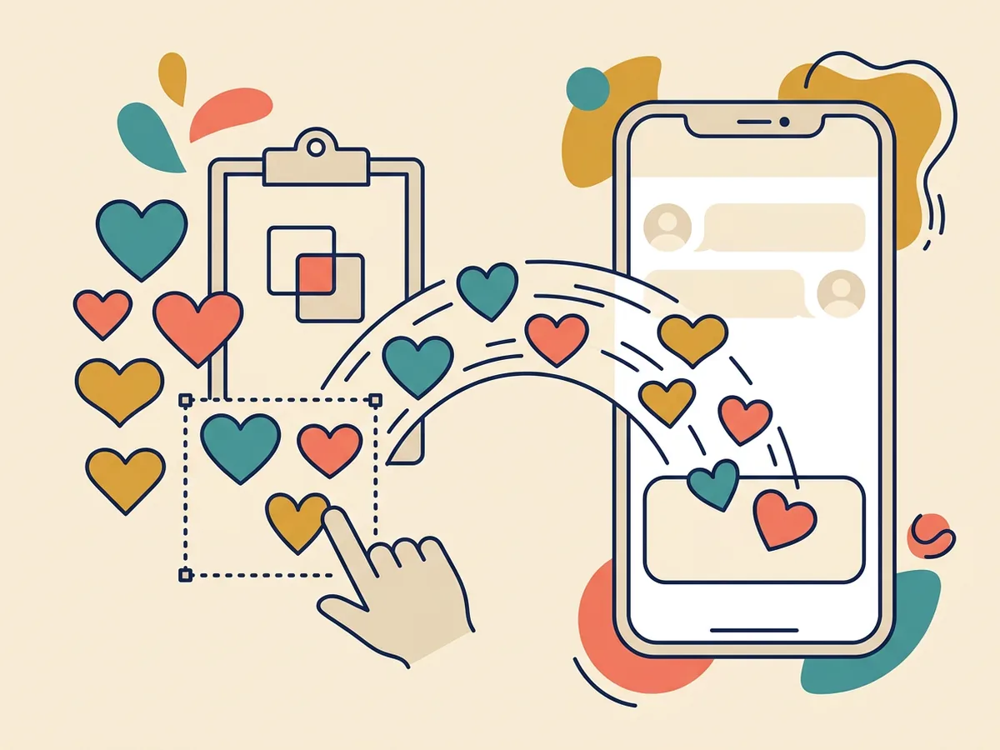

# Love Emojis for WhatsApp: Copy and Paste Ideas

Looking for love emojis to copy and paste into WhatsApp? Start with the words you want to send, then add one emoji that fits your usual tone. ❤️ can add warmth; 🥰 or 😘 can feel affectionate or playful—but no emoji has one guaranteed meaning.

Use the examples as starting points, not scripts. A message that feels sweet to your partner might feel too forward to a new crush; the relationship and conversation matter more than the emoji alone.

For a quick selection, [browse and copy heart emojis](https://emojispot.world/smileys-emotion/heart/) or explore affectionate faces such as 🥰, 😍 and 😘 in the [affectionate-face collection](https://emojispot.world/smileys-emotion/face-affection/).

## Quick love emoji combinations to copy

| Emoji | A possible tone | Message idea |
|---|---|---|
| [❤️ Red heart](https://emojispot.world/emoji/red-heart/) | Warm and direct | “I had a lovely time with you ❤️” |
| [💕 Two hearts](https://emojispot.world/emoji/two-hearts/) | Soft or affectionate | “Thanks for making my day brighter 💕” |
| [🥰 Smiling face with hearts](https://emojispot.world/emoji/smiling-face-with-hearts/) | Sweet appreciation | “That was so thoughtful of you 🥰” |
| [😘 Face blowing a kiss](https://emojispot.world/emoji/face-blowing-a-kiss/) | A kiss or playful goodbye | “Good night—talk tomorrow 😘” |
| [💘 Heart with arrow](https://emojispot.world/emoji/heart-with-arrow/) | Playful romance | “This song is very us 💘” |
| [💖 Sparkling heart](https://emojispot.world/emoji/sparkling-heart/) | Extra enthusiasm | “So proud of you—celebrate soon? 💖” |
| [💌 Love letter](https://emojispot.world/emoji/love-letter/) | A little note or message | “A small note to say I’m thinking of you 💌” |
| [❤️‍🔥 Heart on fire](https://emojispot.world/emoji/heart-on-fire/) | Intense, dramatic or teasing | “That outfit ❤️‍🔥” |

These are possible readings, not definitions everyone follows. The same emoji can feel romantic in one chat, friendly in another or simply like the sender’s usual style. When in doubt, let your words do the explaining.

## WhatsApp love messages you can personalize

A short message usually sounds more natural when it says something specific. Borrow an idea below, then change it so it sounds like you:

- **A warm morning message:** “Good morning—hope something makes you smile today 🥰”
- **A thank-you:** “Thanks for being there for me. I really appreciate you ❤️”
- **A light flirt:** “I was hoping we’d get to talk again 😘”
- **After a date or call:** “I had fun today. I’d like to see you again 🙂”
- **A good-night text:** “Good night. Looking forward to tomorrow 💕”
- **A little celebration:** “You worked hard for this. I’m so proud of you 💖”

A copied line is only a starting point. Mentioning the joke, plan or small moment you shared will usually make a message feel more personal than adding a long row of hearts.

## What should you send to a crush?

There is no universally “safe” flirty emoji. If you do not know the other person’s style yet, keep the message friendly and low-pressure. One emoji that feels like you is usually clearer than a string of symbols.

For example, “I liked talking with you—would you like to get coffee this weekend? 🙂” says what you mean. Sending ❤️ alone may leave the other person guessing, and it cannot tell you whether they feel the same way.

If you already trade affectionate messages, a heart or kiss may fit naturally. Pay attention to the conversation rather than treating a quick reply, a heart colour or a single emoji as proof of someone’s intentions.

## Does a heart emoji on WhatsApp always mean romantic love?

No. People use hearts for romance, friendship, family affection, encouragement, thanks and plenty of other reasons. Some send a particular colour because it suits a photo, a team or their personal style.

There is no reliable colour code that explains every WhatsApp message. Read the words and the relationship around the emoji. For more examples, see our [heart emoji colour guide](https://emojispot.world/guides/heart-emoji-colour-meanings/); it treats colour associations as suggestions rather than fixed rules.

## How do I copy and paste a love emoji into WhatsApp?

1. Tap a **Copy** button above to copy an emoji, or choose one from the [heart collection](https://emojispot.world/smileys-emotion/heart/).
2. Open the WhatsApp chat and paste into the message field. On a phone, press and hold the field and choose **Paste**; on a computer, use your usual paste shortcut.
3. Add a few words if the emoji could be read in more than one way, then send when you are ready.

You can also combine an emoji with your own sentence. The words give the recipient more context than the emoji by itself.

## Frequently asked questions

### Which love emoji should I send to my partner?

Choose one that matches how you normally talk together. ❤️, 💕, 🥰 and 😘 are common affectionate choices, but your shared style matters more than a universal ranking.

### Is ❤️ more romantic than 💕?

Not in every conversation. Some people use ❤️ for partners and 💕 for friends; others use them interchangeably. If the distinction matters, say what you mean rather than expecting the colour or shape to do it for you.

### Can I send a heart emoji to a crush?

You can, but the emoji alone cannot communicate a clear invitation or tell you how the other person feels. A friendly sentence with one emoji—and an easy way to say yes or no—is less likely to leave things unclear.

## The simple rule

**Write the message first; add an emoji if it sounds like you.** Hearts and affectionate faces can make a WhatsApp message warmer or more playful, but their meaning still depends on the people and the conversation.

[Browse the heart emoji collection →](https://emojispot.world/smileys-emotion/heart/) · [Explore affectionate faces →](https://emojispot.world/smileys-emotion/face-affection/) · [Read more emoji guides →](https://emojispot.world/guides/)
